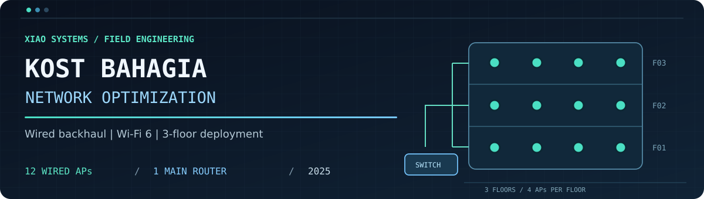
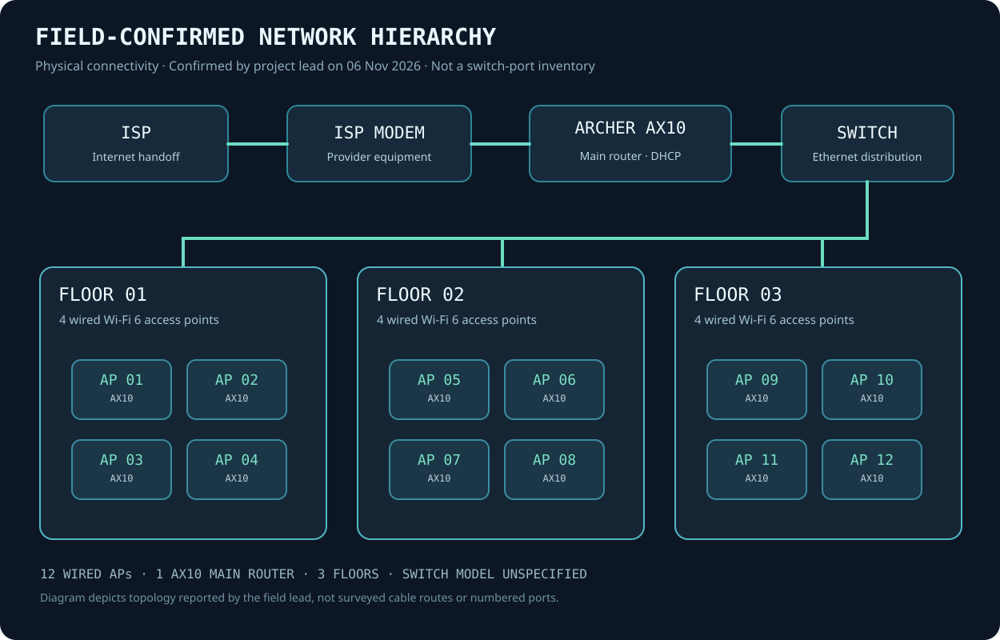
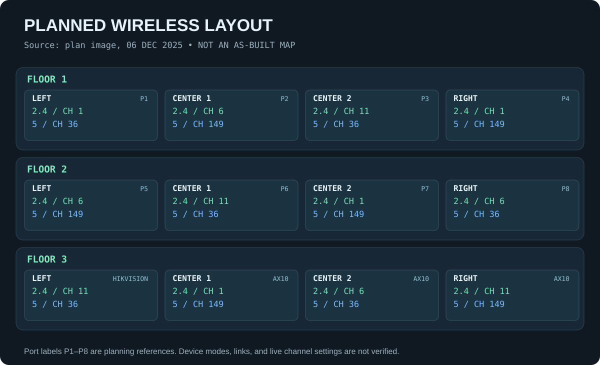
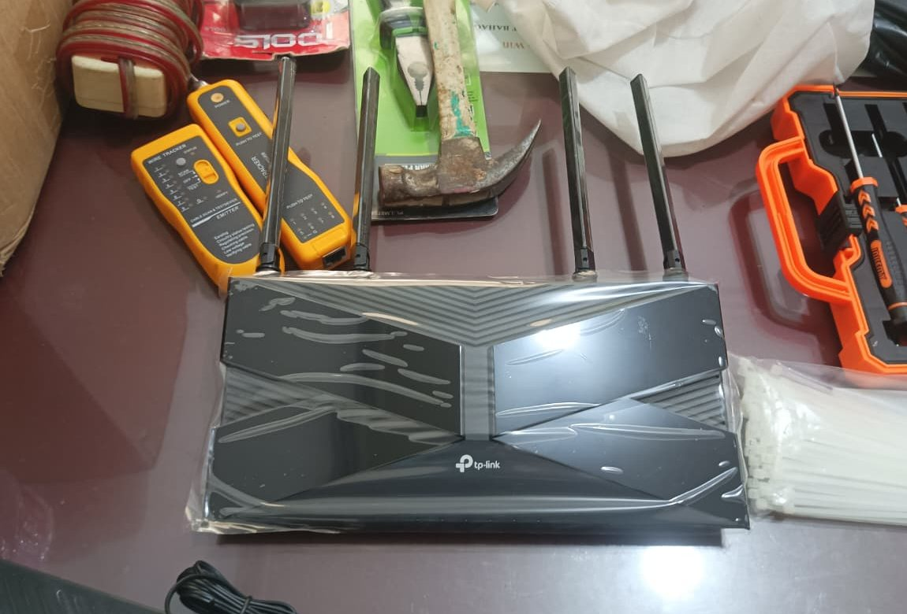
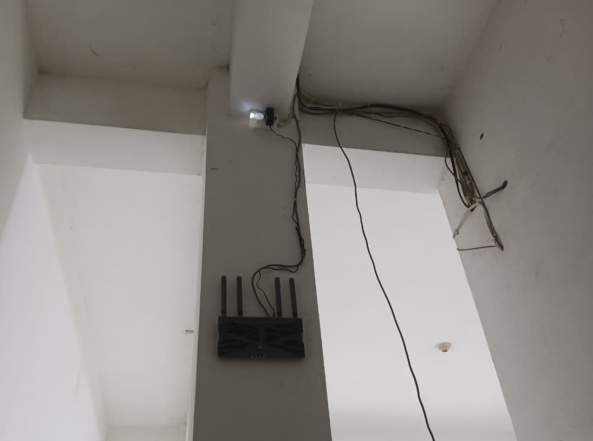
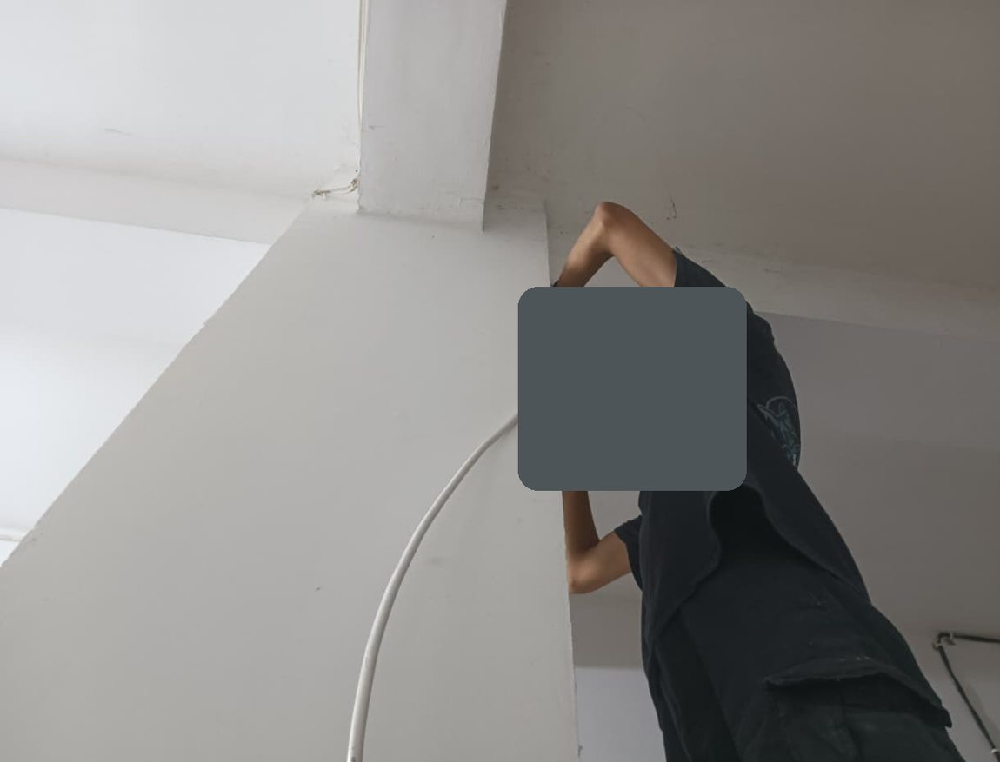

  

  **Implementasi Wi-Fi 6 di bangunan tiga lantai dengan backhaul Ethernet dan perpindahan jaringan yang mulus.**

  [**English**](README.md) · [Diagram jaringan](#arsitektur-jaringan) · [Pekerjaan lapangan](#implementasi-dan-troubleshooting) · [Dokumentasi teknis](#dokumentasi)

## Ringkasan proyek

**Kost Bahagia Network Optimization** merupakan proyek jaringan lapangan di **Palembang, Sumatera Selatan, Indonesia**, pada **November-Desember 2025**. Pekerjaan dilaksanakan oleh **[Xiao Systems](https://xiaosystems.id)** dan dipimpin oleh **[Ahmad Ghumaydi](https://github.com/gumaydi)**. Tim menata distribusi Ethernet dan sistem Wi-Fi antarlantai, sekaligus mengganti perangkat Wi-Fi sebelumnya menjadi keluarga TP-Link Archer AX10.

**Lokasi proyek:** [Rumah Kost Bahagia](https://maps.app.goo.gl/PUBwb3aVc16ZVJdp6) · Jl. Jenderal Ahmad Yani, Lorong Bahagia No. 83, 9/10 Ulu, Kota Palembang, Sumatera Selatan 30116, Indonesia.

| Implementasi | Kondisi akhir berdasarkan keterangan lapangan |
| :-- | :-- |
| Lingkungan | **3 lantai**, masing-masing **4 access point** |
| Titik Wi-Fi | **12 x TP-Link Archer AX10 Wi-Fi 6** sebagai AP berkabel |
| Router utama | **1 x TP-Link Archer AX10** |
| Jalur jaringan | Modem ISP -> router utama -> distribusi switch Ethernet -> AP berkabel |
| Pengaturan Wi-Fi | SSID/password seragam; DHCP di router utama; AP dalam mode access point |
| Hasil lapangan | Seluruh 12 AP berfungsi; perpindahan antararea berlangsung mulus menurut ketua proyek |

## Masalah yang diselesaikan

Hunian bertingkat membutuhkan koneksi yang menjangkau berbagai kamar dan lantai tanpa membuat pengguna berpindah jaringan Wi-Fi secara manual. Tujuan pengerjaan adalah menata distribusi kabel, menyediakan empat AP per lantai, dan menghadirkan pengalaman koneksi yang konsisten saat pengguna bergerak di dalam bangunan.

## Pekerjaan Xiao Systems

- **Distribusi berkabel:** instalasi kabel Ethernet dan pemasangan perangkat melalui jaringan router dan switch, didukung foto proses pekerjaan.
- **Standarisasi perangkat:** mengganti perangkat Wi-Fi awal dengan **12 Archer AX10 sebagai AP** dan satu Archer AX10 terpisah sebagai router utama.
- **Konfigurasi wireless:** penggunaan SSID dan password yang sama, DHCP terpusat, dan mode AP. Rencana kanal 2,4/5 GHz tersimpan sebagai dokumen perencanaan historis.
- **Penyelesaian lapangan:** pemeriksaan konektivitas, penanganan laporan gangguan pada satu titik, serta konfirmasi akhir seluruh AP beroperasi dari ketua proyek.

## Arsitektur jaringan

Diagram menggambarkan **hierarki koneksi logis dan Ethernet berdasarkan konfirmasi lapangan**, bukan hasil survei seluruh jalur kabel atau ekspor port switch. [Penjelasan arsitektur dan rencana kanal](docs/network-architecture.md).

<strong>Lihat diagram rencana kanal awal</strong> (6 Desember 2025)

Diagram tersebut adalah rencana radio terdokumentasi, sebelum seluruh perangkat Wi-Fi diseragamkan. [Perbandingan rencana dan implementasi](docs/network-architecture.md#original-radio-plan-6-december-2025).

## Implementasi dan troubleshooting

Arsip mencatat pembelian dan persiapan pada akhir November, persiapan perangkat serta perencanaan kanal pada awal Desember, kemudian aktivitas pemasangan pada **7, 13, dan 14 Desember 2025**. Pada **15 Desember**, salah satu titik AP (label disamarkan) dilaporkan tidak aktif. Sambungan listrik yang longgar sempat menjadi dugaan, tetapi detail perbaikannya tidak tercatat. Ketua proyek kemudian mengonfirmasi **semua AP sudah berjalan normal**.

[Kronologi implementasi](docs/implementation.md) · [Riwayat gangguan](docs/troubleshooting.md) · [Inventaris perangkat](docs/hardware-inventory.md)

## Hasil lapangan

| Aspek | Hasil yang dicatat | Jenis bukti |
| :-- | :-- | :-- |
| Implementasi selesai | **12 AP beroperasi di 3 lantai** | Keterangan langsung ketua proyek |
| Perpindahan klien | **Mulus / seamless saat digunakan** | Pengamatan lapangan ketua proyek |
| Screenshot pengujian, 7 Des 2025 | **338 Mbps unduh / 354 Mbps unggah** | Satu tangkapan layar Speedtest |

Screenshot Speedtest merupakan satu pengamatan, bukan perbandingan sebelum dan sesudah. Pengalaman seamless juga bukan bukti terukur bahwa fitur 802.11r/k/v aktif. Batasan hasil pengukuran dijelaskan dalam [Pengujian dan hasil](docs/testing-and-results.md).

## Galeri pekerjaan lapangan

Foto di bawah merupakan **dokumentasi asli pemasangan pada 2025** yang telah disanitasi, bukan ilustrasi. Identitas pribadi dan bagian yang tidak diperlukan telah ditutup atau dipotong.

| Perangkat dan peralatan | AP terpasang | Penarikan kabel Ethernet |
| :--: | :--: | :--: |
|  |  |  |

[Lihat ketujuh foto proyek di galeri lengkap](docs/project-gallery.md), termasuk hasil Speedtest pada arsip. Metadata foto asli tidak dimasukkan dalam paket publik. Foto stok maupun AI tidak digunakan sebagai dokumentasi lapangan.

## Dokumentasi

| Bagian | Dokumen |
| :-- | :-- |
| Konteks | [Gambaran proyek](docs/project-overview.md) · [Kebutuhan](docs/requirements.md) |
| Desain teknis | [Arsitektur](docs/network-architecture.md) · [Inventaris](docs/hardware-inventory.md) |
| Pelaksanaan | [Kronologi lapangan](docs/implementation.md) · [Troubleshooting](docs/troubleshooting.md) |
| Bukti dan hasil | [Pengujian](docs/testing-and-results.md) · [Indeks bukti](docs/evidence-index.md) |
| Visual dan pembelajaran | [Dokumentasi visual](docs/project-gallery.md) · [Pelajaran teknis](docs/lessons-learned.md) |

## Kredit proyek

**Pelaksana:** [Xiao Systems](https://xiaosystems.id)  
**Ketua proyek:** [Ahmad Ghumaydi](https://github.com/gumaydi) ([website](https://ghumaydi.my.id))  
**Implementasi:** tim lapangan Xiao Systems dengan tanggung jawab teknis bersama. Identitas wajah anggota tim tidak ditampilkan dan nama anggota lain tidak dicantumkan.

**Dasar dokumentasi:** arsip percakapan, foto, serta screenshot pengujian dari 2025 dipisahkan dari keterangan langsung ketua proyek pada **6 November 2026**. [Indeks sumber dan tingkat bukti](docs/evidence-index.md). Ketua proyek telah mengonfirmasi izin publikasi nama, alamat, tautan Maps, serta foto instalasi yang sudah disanitasi pada 6 November 2026. Wajah pekerja tidak ditampilkan. Informasi akses administrasi jaringan dan ekspor WhatsApp asli tidak dipublikasikan.
