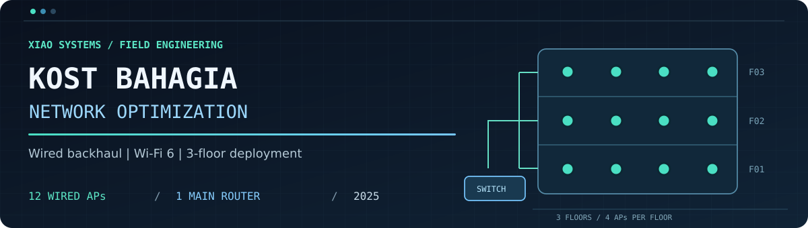
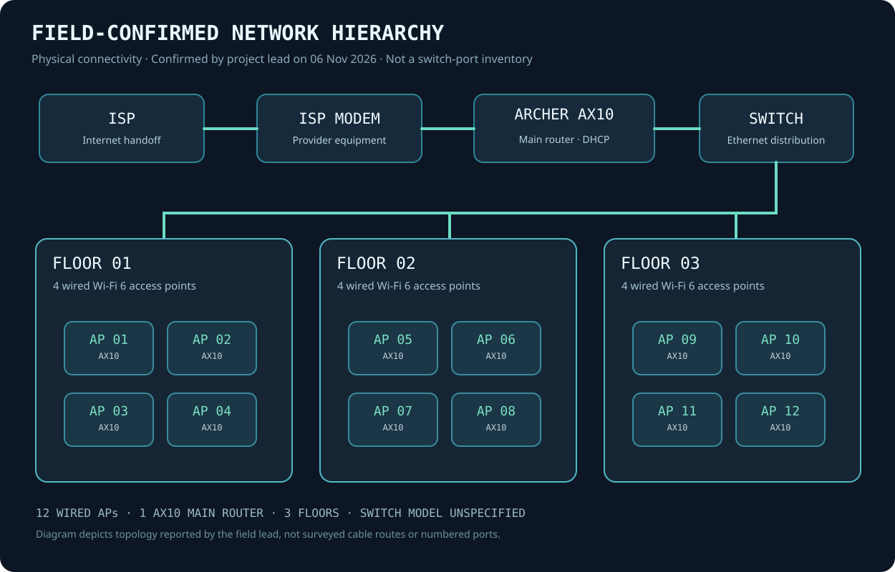
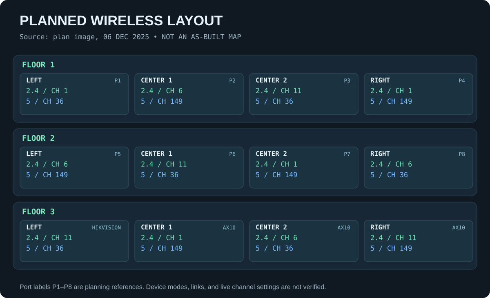
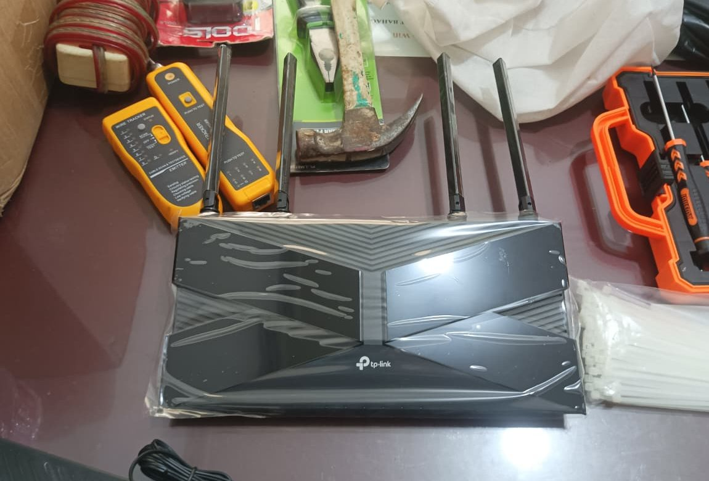
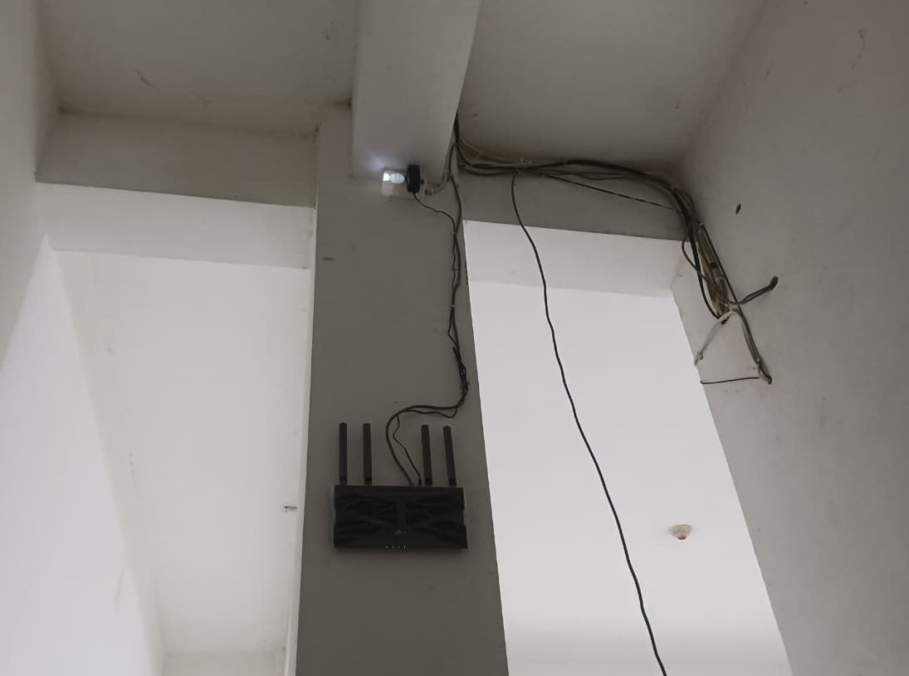
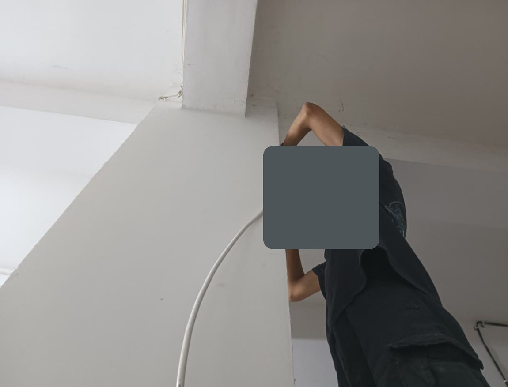

  

  **A three-floor Wi-Fi 6 deployment built around wired backhaul and practical network continuity.**

  [**Bahasa Indonesia**](README.id.md) · [Network diagram](#network-architecture) · [Field work](#implementation-and-troubleshooting) · [Technical documentation](#documentation)

## At a glance

**Kost Bahagia Network Optimization** is a field networking project undertaken in **Palembang, South Sumatra, Indonesia**, during **November-December 2025**. Delivered by **[Xiao Systems](https://xiaosystems.id)** and led by **[Ahmad Ghumaydi](https://github.com/gumaydi)**, the work organized wired distribution and a consistent multi-floor wireless setup. The project standardized previously mixed Wi-Fi equipment on TP-Link Archer AX10 units.

**Project site:** [Rumah Kost Bahagia](https://maps.app.goo.gl/PUBwb3aVc16ZVJdp6) · Jl. Jenderal Ahmad Yani, Lorong Bahagia No. 83, 9/10 Ulu, Palembang, South Sumatra 30116, Indonesia.

| Deployment | As-built record |
| :-- | :-- |
| Property layout | **3 floors**, **4 access points per floor** |
| Wireless endpoints | **12 x TP-Link Archer AX10 Wi-Fi 6** in wired AP roles |
| Gateway | **1 x TP-Link Archer AX10** as the main router |
| Network path | ISP modem -> main router -> Ethernet switch distribution -> wired APs |
| Wi-Fi setup | Shared SSID/credentials; DHCP at the main router; AP-mode endpoints |
| Field outcome | All 12 APs operational; smooth transitions between Wi-Fi areas reported by the project lead |

## The challenge

A multi-floor residence needs reliable connectivity across different rooms and floors without making users manually switch between separate Wi-Fi networks. The engineering goal was to organize Ethernet distribution, deploy four access points per floor, and create a consistent wireless experience while moving around the building.

## What Xiao Systems implemented

- **Wired distribution:** routed Ethernet to the Wi-Fi endpoints through the router-and-switch network, with cabling and physical installation documented in project photographs.
- **Device standardization:** replaced the early mix of wireless equipment with **12 Archer AX10 access points** and one separate Archer AX10 main router.
- **Wireless configuration:** used a common SSID and password, central DHCP, and AP-mode operation. A dated 2.4/5 GHz channel plan is preserved as the original planning record.
- **Field commissioning:** checked connectivity, responded to an endpoint incident, and completed the deployment with all APs working according to the field team lead.

## Network architecture

The diagram represents the **reported as-built logical and wired hierarchy**, not a surveyed cable route or switch-port export. [Architecture details and the original channel plan](docs/network-architecture.md).

<strong>View original channel-planning diagram</strong> (6 December 2025)

The archived sheet illustrates the early radio plan. Final AP hardware was standardized after that version. [Planning comparison](docs/network-architecture.md#original-radio-plan-6-december-2025).

## Implementation and troubleshooting

The archive records procurement and preparation in late November, equipment staging and channel planning in early December, and hands-on installation activity on **7, 13, and 14 December 2025**. On **15 December**, one anonymized AP endpoint was reported inactive. A loose power connection was discussed as a possibility; the exact repair was not documented. The project lead subsequently confirmed that **all endpoints were operating normally**.

[Implementation timeline](docs/implementation.md) · [Incident record](docs/troubleshooting.md) · [Hardware inventory](docs/hardware-inventory.md)

## Field results

| Observation | Recorded result | Evidence type |
| :-- | :-- | :-- |
| Completed deployment | **12 APs operational across 3 floors** | Project lead's firsthand account |
| Client movement | **Smooth / seamless in practical use** | Project lead's field observation |
| Network speed capture, 7 Dec 2025 | **338 Mbps download / 354 Mbps upload** | Single archived Speedtest screenshot |

The Speedtest is a point-in-time capture, not a controlled before-and-after measurement. Practical seamless use does not independently establish 802.11r/k/v support or a measured handoff time. Further evidence boundaries are consolidated in [Testing and results](docs/testing-and-results.md).

## Field gallery

The following are **sanitized photographs from the actual 2025 installation**, not illustrations. Personal identities and unnecessary private details have been removed or cropped.

| Equipment and tools | Installed Wi-Fi unit | Ethernet cable routing |
| :--: | :--: | :--: |
|  |  |  |

[**Browse the full seven-photo project gallery**](docs/project-gallery.md) for more installation records and the archived speed-test capture. Original photo metadata is not included in the public files. No AI-generated or stock imagery is presented as field evidence.

## Documentation

| Explore | Documents |
| :-- | :-- |
| Project context | [Overview](docs/project-overview.md) · [Requirements](docs/requirements.md) |
| Engineering design | [Network architecture](docs/network-architecture.md) · [Hardware inventory](docs/hardware-inventory.md) |
| Execution | [Field timeline](docs/implementation.md) · [Troubleshooting](docs/troubleshooting.md) |
| Evidence and outcomes | [Testing and results](docs/testing-and-results.md) · [Evidence index](docs/evidence-index.md) |
| Visuals and learning | [Visual documentation](docs/project-gallery.md) · [Lessons learned](docs/lessons-learned.md) |

## Project credits

**Project delivery:** [Xiao Systems](https://xiaosystems.id)  
**Project lead:** [Ahmad Ghumaydi](https://github.com/gumaydi) ([personal website](https://ghumaydi.my.id))  
**Implementation:** Xiao Systems field team, sharing technical responsibilities. Team members are not identified in photographs; individual names are not published.

**Evidence approach:** archived 2025 group messages, field images and an archived speed-test screenshot are distinguished from direct project-lead clarification received on **6 November 2026**. [Source and evidence classification](docs/evidence-index.md). The project lead confirmed permission to publish the site name, site address, Maps link, and sanitized installation images on 6 November 2026. Worker faces are not shown. No administrative network access information or raw WhatsApp files are published.
