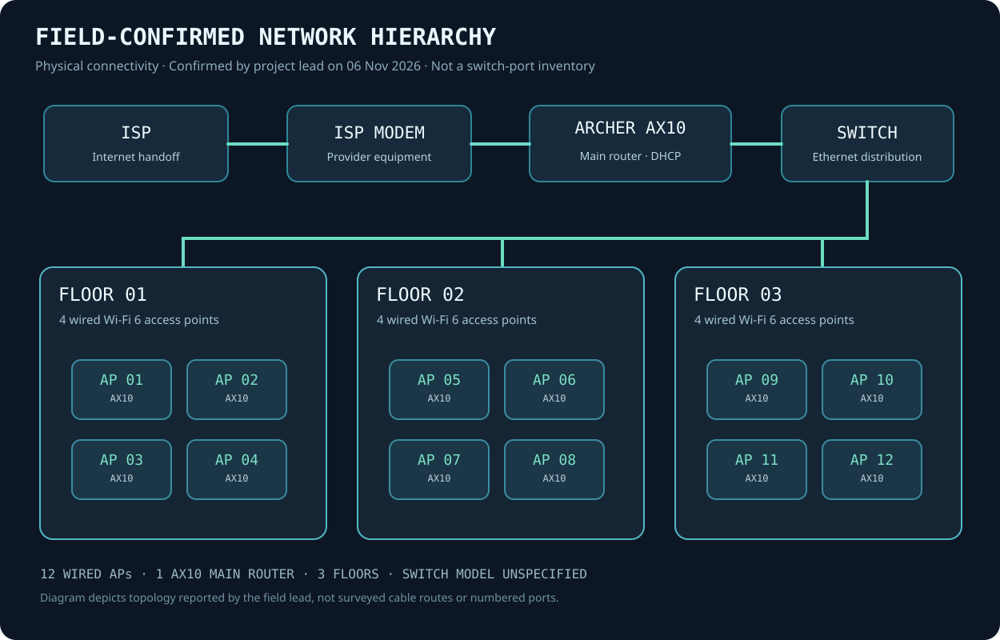
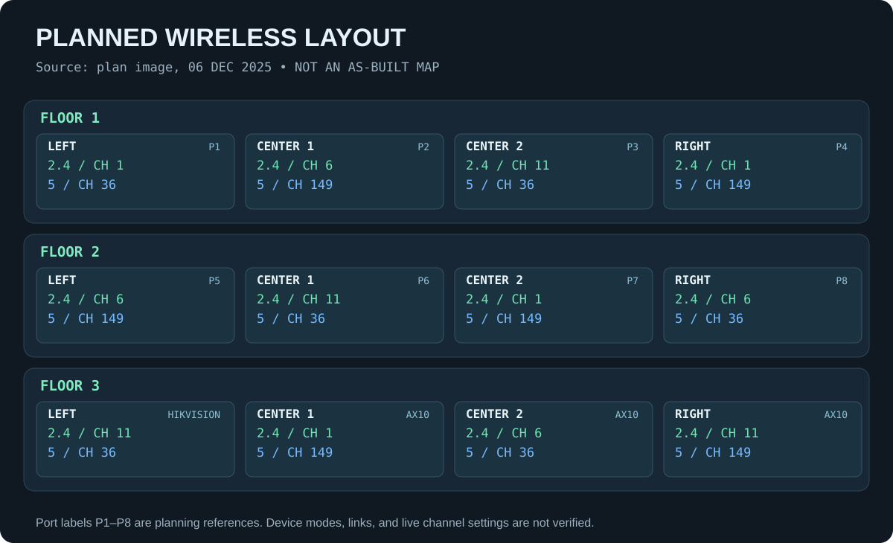

# Network architecture: field confirmation and original planning

[Home](../README.md) · [Evidence](evidence-index.md)

## Confirmed deployment architecture

On **6 November 2026**, the project's field lead confirmed the final connection sequence and installed quantities:

```text
ISP access → ISP modem → TP-Link Archer AX10 (main router / DHCP)
                               ↓
                         Ethernet switch
                 ┌─────────────┼─────────────┐
                 ↓             ↓             ↓
              Floor 1       Floor 2       Floor 3
              4 AX10 APs    4 AX10 APs    4 AX10 APs
```



All 12 APs are wired to the switch distribution and operate in AP roles, with one additional AX10 as the primary router. Early wireless equipment was replaced with AX10 devices. This describes the connectivity reported by the installer, not a switch-exported port map. **Switch vendor/model, physical path and port numbering are not documented conclusively.**

The lead confirms a common wireless name/password, centralized DHCP and AP operation, as well as smooth client movement between Wi-Fi areas. No surviving controller backup or device configuration proves a specific 802.11k/v/r handoff mechanism, and there are no timed roaming traces. A shared SSID does not itself prove standards-based fast roaming.

## Original radio plan: 6 December 2025



| Floor | Position | Original port or device label | Planned 2.4 GHz | Planned 5 GHz |
| :-- | :-- | :-- | --: | --: |
| 1 | Left | Port 1 | 1 | 36 |
| 1 | Center 1 | Port 2 | 6 | 149 |
| 1 | Center 2 | Port 3 | 11 | 36 |
| 1 | Right | Port 4 | 1 | 149 |
| 2 | Left | Port 5 | 6 | 149 |
| 2 | Center 1 | Port 6 | 11 | 36 |
| 2 | Center 2 | Port 7 | 1 | 149 |
| 2 | Right | Port 8 | 6 | 36 |
| 3 | Left | Hikvision (replaced) | 11 | 36 |
| 3 | Center 1 | AX10 | 1 | 149 |
| 3 | Center 2 | AX10 | 6 | 36 |
| 3 | Right | AX10 | 11 | 149 |

This is a transcription of a chat-shared worksheet (`IMG-20251206-WA0006.jpg`, 6 Dec 19:19). **It is a historical plan.** The former Hikvision label is retained only to make changes auditable; the lead later confirmed replacement with AX10. Channels 1/6/11 and 36/149 illustrate the planning approach, not independently captured live channel settings.

## Data requiring a live site export

Switch brand/model and total port count, AP-to-port mapping, cable length and pathway, channel width and actual channel allocation, DHCP settings, firmware, management IP assignments, VLAN presence, and optional roaming-assistance features. These do not change the lead-confirmed physical-device count or wiring hierarchy.
