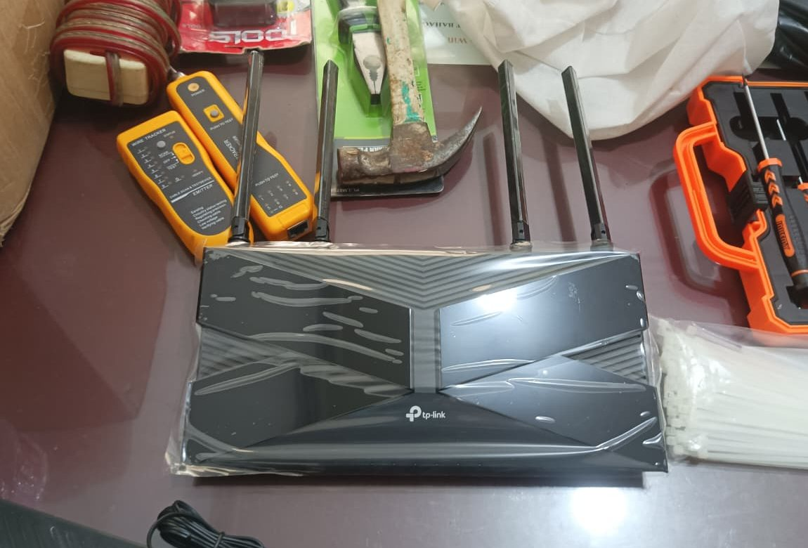
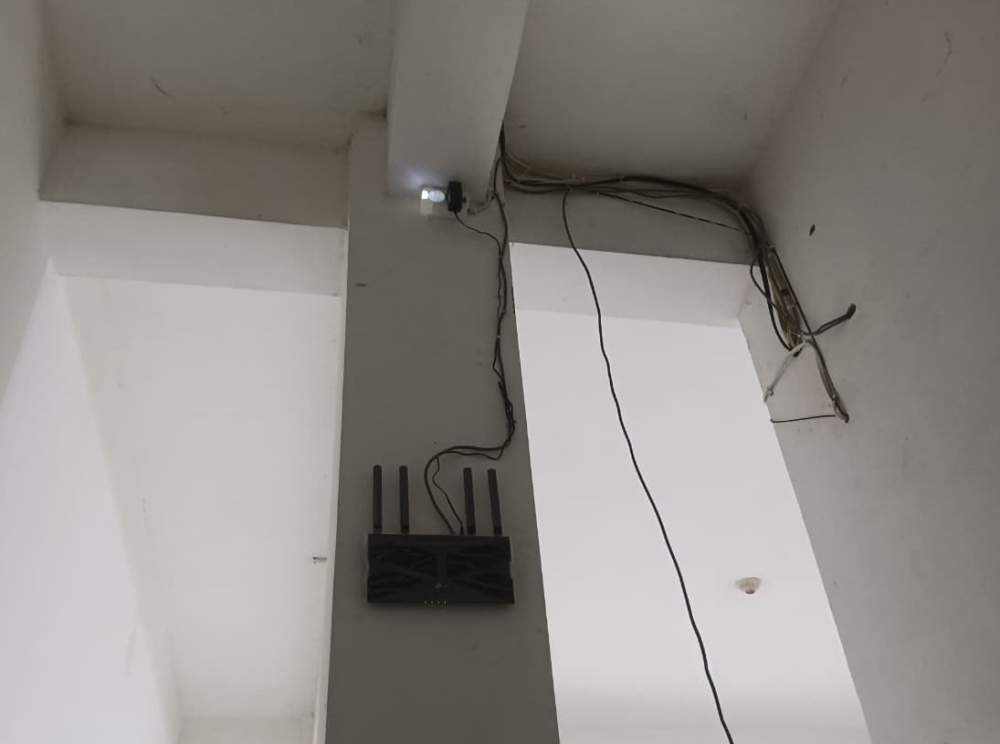
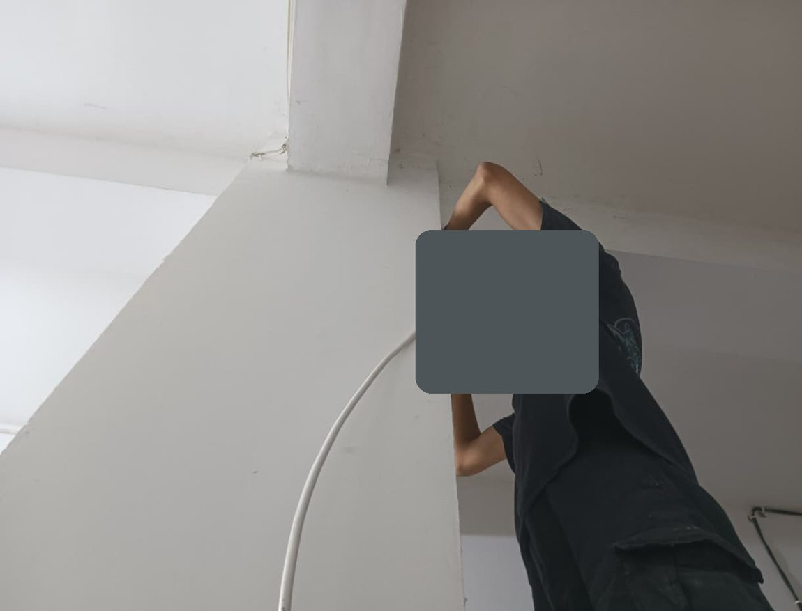
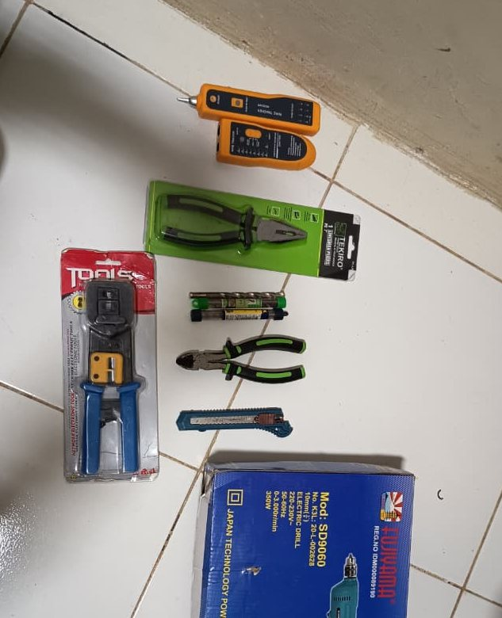
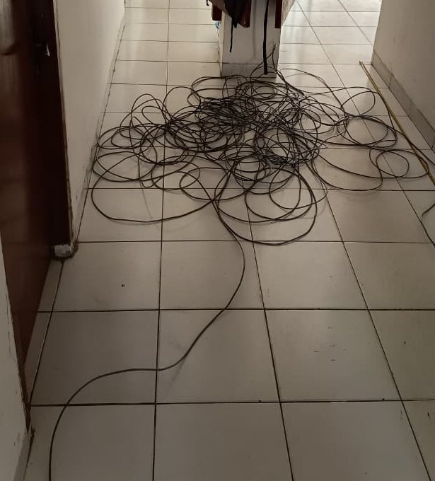
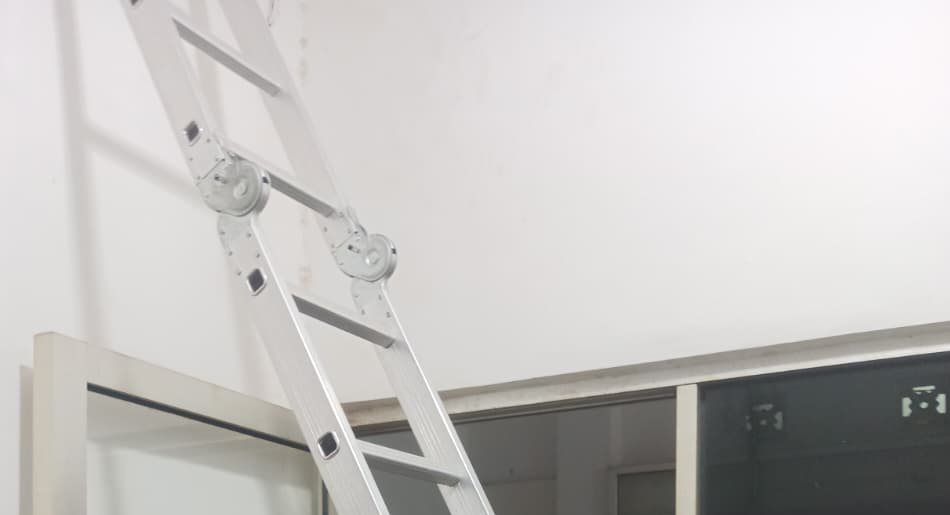
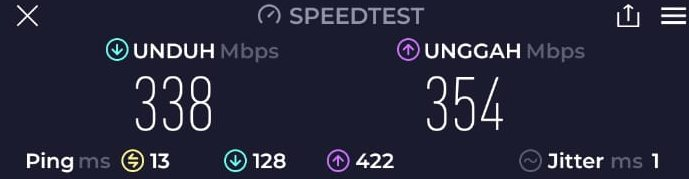
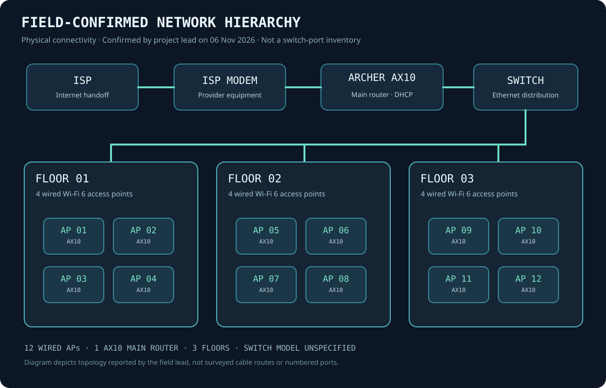
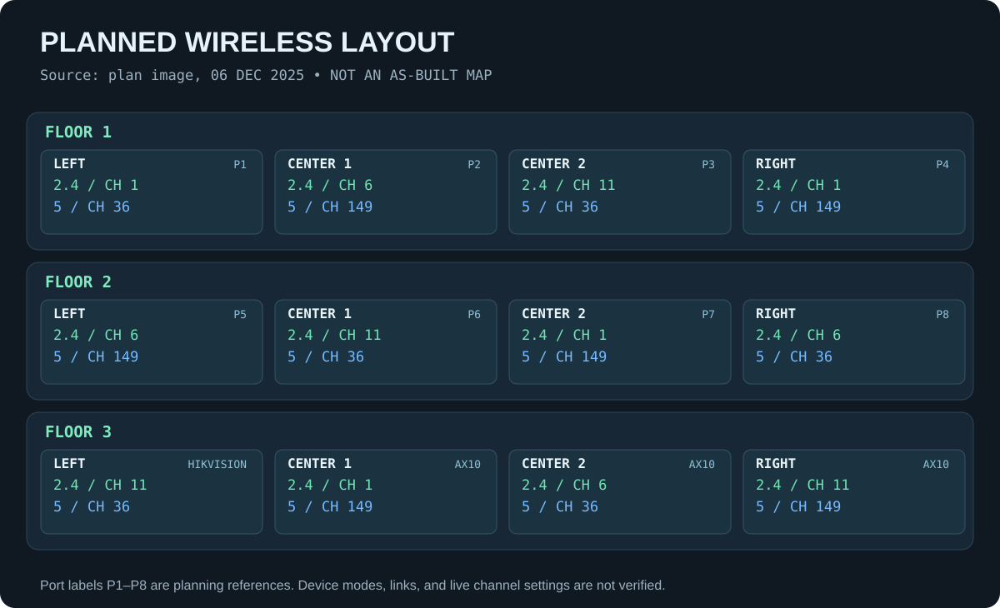

# Visual documentation / Dokumentasi visual

[Home](../README.md) · [Bahasa Indonesia](../README.id.md)

## Actual installation photography / Foto instalasi asli

These seven images are **sanitized crops of archival project photos** from December 2025. The crew member's face has been permanently masked or excluded through cropping, and all exported JPEGs have been re-encoded without EXIF or phone metadata. Captions describe only what is visible in each image. / Ketujuh gambar adalah potongan foto arsip Desember 2025 yang sudah disanitasi. Wajah anggota tim ditutup permanen atau tidak termasuk dalam potongan foto, dan metadata kamera dihapus.

| Photo / Foto | Description / Keterangan |
| :-- | :-- |
|  | **Equipment staging / Persiapan perangkat:** TP-Link Wi-Fi hardware and installation tools photographed together. |
|  | **Mounted equipment / Pemasangan perangkat:** Wi-Fi unit attached to a column near wiring. This image shows one installation, not the entire network. |
|  | **Cable routing / Penarikan kabel:** installer handling cable near a ceiling; visible head area has been obscured. |
|  | **Field toolkit / Peralatan lapangan:** crimping, cutting, tracing and drilling tools prepared on-site. |
|  | **Cable work in progress / Pengerjaan kabel:** cable lengths on the floor during installation. Not a photograph of the finished cable management. |
|  | **Elevated access / Akses ketinggian:** upper section of the ladder used during installation; the worker has been cropped out. |
|  | **Archived test capture / Hasil uji arsip:** 7 Dec 2025, 338 Mbps down and 354 Mbps up; cropped to omit the test ID and unrelated screen information. This is a single sample, not a before/after study. |

## Network diagrams / Diagram jaringan

*Field-confirmed ISP modem → AX10 router → Ethernet switch → twelve wired AX10 APs over three floors. Diagram is logical, not an exact cable/port map.*

*Historical 6 Dec 2025 channel-planning sheet. The final hardware inventory superseded its earlier device labels.*

## Publication and evidence notes / Catatan publikasi

Permission to publish the property identity, precise location, and **sanitized installation photographs** was confirmed by the project lead on 6 November 2026. Unredacted originals and the WhatsApp archive are not distributed. Faces and identifiable member credits are excluded; equipment configuration secrets, exact internal IPs and administrative credentials are also omitted.
